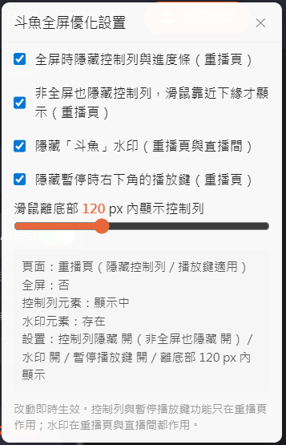

# 斗魚全屏隱藏進度條（Chrome 擴充 / Tampermonkey 腳本）

**繁體中文** | [简体中文](README.zh-CN.md)

## 背景

斗魚視頻（v.douyu.com）全屏播放時，滑鼠閒置後控制列會收起，但畫面底部仍留一條紅色細進度條，看片時很礙眼。
官方播放器沒有提供關閉它的設置，所以做一個瀏覽器擴充插件處理。

## 功能

- **全屏隱藏控制列**（重播頁限定）：

  進入全屏（點播放器右下角「進入全屏」）→ 整條底部控制列（含細進度條）隱藏；
  滑鼠移到畫面下緣 → 控制列出現，可正常拖進度條、調音量；
  離開下緣區 → 延遲 0.3 秒後隱藏。

- **非全屏也隱藏控制列**（重播頁，可選、預設開）：
  非全屏時控制列與進度條不常駐（暫停時也一樣），滑鼠移到播放器下緣才出現、離開後 0.3 秒隱藏。

- **隱藏暫停播放鍵**（重播頁，可選、預設開）：
  暫停時右下角的大圈播放鍵一併移除。

- **隱藏「斗魚」水印**（重播頁與直播間）：

  - 重播頁的水印是 DOM 覆蓋層（`<demand-video-watermark>`）；
  - 直播間（www.douyu.com，含未開播輪播）的水印是播放器容器內 class 帶 hash 的 div（「斗鱼 房间号：…」）。

  兩種都全程隱藏（不限全屏）。

- **設置面板**：

  - 擴充版點工具列圖示、Tampermonkey 腳本版點 Tampermonkey 圖示 →「斗魚優化設置」。

  - 可即時開關功能、調整「滑鼠離底部 X px 內顯示控制列」的距離，

  - 並顯示目前分頁的除錯資訊（頁面類型、全屏狀態、控制列／水印元素是否找到、是否已隱藏）；

    擴充版設置存放於 `chrome.storage.sync`、Tampermonkey 版存放於 `GM_setValue`。

- **網頁全屏**的控制行為交由「非全屏」控制項設定。

- 控制列功能只作用於 v.douyu.com 重播頁；直播間只處理水印，控制列維持斗魚原生行為。

## 安裝

兩種擇一即可（同時裝會重複做同樣的事）：

**Tampermonkey 腳本**

1. 瀏覽器安裝 [Tampermonkey](https://www.tampermonkey.net/) 擴充

   1. Greasy Fork [鏈結](https://greasyfork.org/zh-TW/scripts/603642-%E6%96%97%E9%B1%BC%E9%9A%90%E8%97%8F%E8%BF%9B%E5%BA%A6%E6%9D%A1-%E6%B0%B4%E5%8D%B0)

   2. 手動安裝

      點 Tampermonkey 圖示 →「新增腳本」，把 `userscript/douyu-hide-progressbar.user.js` 的內容整份貼入並儲存（或把該檔拖進瀏覽器讓 Tampermonkey 安裝）

2. 開斗魚頁面，點 Tampermonkey 圖示 →「斗魚優化設置」開啟設置面板

**Chrome 擴充**

1. 開啟 Chrome，網址列輸入 `chrome://extensions`
2. 右上角打開「開發人員模式」
3. 點左上角「載入未封裝項目」
4. 選擇本專案的 `extension` 資料夾 ([下載鏈結](https://github.com/happk/douyu-hide-progressbar/releases))
5. 開一個斗魚視頻頁面，進全屏測試
6. 點工具列圖示開啟設置面板

更新版本後：Tampermonkey 腳本貼回新內容儲存、Chrome 擴充則在 `chrome://extensions` 按「重新載入」（↻），並再次重新整理斗魚分頁。

## 設置

- 擴充插件：點工具列圖示的彈出視窗；
- Tampermonkey 腳本版：Tampermonkey 圖示 →「斗魚優化設置」的頁內面板。

兩者項目相同：

| 設置 | 預設 | 作用 |
|------|------|------|
| 全屏時隱藏控制列與進度條（重播頁） | 開 | 主要功能，只在重播頁作用 |
| 非全屏也隱藏控制列，滑鼠靠近下緣才顯示（重播頁） | 開 | 非全屏控制列不常駐（含暫停時）；離開下緣 0.3 秒隱藏 |
| 隱藏「斗魚」水印（重播頁與直播間） | 開 | 全程隱藏，不限全屏 |
| 隱藏暫停時右下角的播放鍵（重播頁） | 開 | 暫停時右下角的大圈播放鍵 |
| 滑鼠離底部 X px 內顯示控制列 | 120 px | 滑鼠游標進入（全屏時）視窗底／（非全屏時）播放器底緣這個高度範圍時，控制列出現； 離開後 0.3 秒隱藏（60–240） |

- `content.js` 開頭的 `DEFAULTS` 是預設值；
- `HIDE_DELAY`（離開下緣區的延遲，300ms）仍是固定常數，要改才需要動檔案。

## 檔案

- `extension/` — Chrome 擴充版（MV3：manifest.json、content.js、popup.html、popup.js）
- `userscript/douyu-hide-progressbar.user.js` — Tampermonkey 腳本版（行為與擴充相同）
- `changelog.md` — 版本歷史（版本依據以此為準）

## 已知限制

- 斗魚改版更動播放器 DOM 結構時，功能可能失效（不影響頁面本身）。
