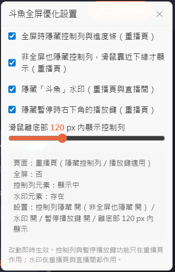

# 斗鱼全屏隐藏进度条（Chrome 扩展 / Tampermonkey 脚本）

[繁體中文](README.md) | **简体中文**

## 背景

斗鱼视频（v.douyu.com）全屏播放时，鼠标闲置后控制栏会收起，但画面底部仍留一条红色细进度条，看片时很碍眼。
官方播放器没有提供关闭它的设置，所以做一个浏览器扩展插件处理。

## 功能

- **全屏隐藏控制栏**（重播页限定）：

  进入全屏（点播放器右下角「进入全屏」）→ 整条底部控制栏（含细进度条）隐藏；
  鼠标移到画面下缘 → 控制栏出现，可正常拖进度条、调音量；
  离开下缘区 → 延迟 0.3 秒后隐藏。

- **非全屏也隐藏控制栏**（重播页，可选、默认开）：
  非全屏时控制栏与进度条不常驻（暂停时也一样），鼠标移到播放器下缘才出现、离开后 0.3 秒隐藏。

- **隐藏暂停播放键**（重播页，可选、默认开）：
  暂停时右下角的大圈播放键一并移除。

- **隐藏「斗鱼」水印**（重播页与直播间）：

  - 重播页的水印是 DOM 覆盖层（`<demand-video-watermark>`）；
  - 直播间（www.douyu.com，含未开播轮播）的水印是播放器容器内 class 带 hash 的 div（「斗鱼 房间号：…」）。

  两种都全程隐藏（不限全屏）。

- **设置面板**：

  - 扩展版点工具栏图标、Tampermonkey 脚本版点 Tampermonkey 图标 →「斗鱼优化设置」。

  - 可即时开关功能、调整「鼠标离底部 X px 内显示控制栏」的距离，

  - 并显示目前标签页的调试信息（页面类型、全屏状态、控制栏／水印元素是否找到、是否已隐藏）；

    扩展版设置存放于 `chrome.storage.sync`、Tampermonkey 版存放于 `GM_setValue`。

- **网页全屏**的控制行为交由「非全屏」控制项设定。

- 控制栏功能只作用于 v.douyu.com 重播页；直播间只处理水印，控制栏维持斗鱼原生行为。

## 安装

两种择一即可（同时装会重复做同样的事）：

**Tampermonkey 脚本（建议）**

1. 浏览器安装 [Tampermonkey](https://www.tampermonkey.net/) 扩展
2. 点 Tampermonkey 图标 →「添加新脚本」，把 `userscript/douyu-hide-progressbar.user.js` 的内容整份贴入并保存（或把该文件拖进浏览器让 Tampermonkey 安装）
3. 开斗鱼页面，点 Tampermonkey 图标 →「斗鱼优化设置」打开设置面板

**Chrome 扩展（加载未打包）**

1. 打开 Chrome，地址栏输入 `chrome://extensions`
2. 右上角打开「开发者模式」
3. 点左上角「加载已解压的扩展程序」
4. 选择本项目的 `extension` 文件夹
5. 开一个斗鱼视频页，进全屏测试
6. 点工具栏图标打开设置面板

更新版本后：Tampermonkey 脚本贴回新内容保存、Chrome 扩展则在 `chrome://extensions` 按「重新加载」（↻），并再次刷新斗鱼标签页。

## 设置

- 扩展插件：点工具栏图标的弹出窗口；
- Tampermonkey 脚本版：Tampermonkey 图标 →「斗鱼优化设置」的页内面板。

两者项目相同：

| 设置 | 默认 | 作用 |
|------|------|------|
| 全屏时隐藏控制栏与进度条（重播页） | 开 | 主要功能，只在重播页作用 |
| 非全屏也隐藏控制栏，鼠标靠近下缘才显示（重播页） | 开 | 非全屏控制栏不常驻（含暂停时）；离开下缘 0.3 秒隐藏 |
| 隐藏「斗鱼」水印（重播页与直播间） | 开 | 全程隐藏，不限全屏 |
| 隐藏暂停时右下角的播放键（重播页） | 开 | 暂停时右下角的大圈播放键 |
| 鼠标离底部 X px 内显示控制栏 | 120 px | 鼠标指针进入（全屏时）窗口底／（非全屏时）播放器底缘这个高度范围时，控制栏出现； 离开后 0.3 秒隐藏（60–240） |

- `content.js` 开头的 `DEFAULTS` 是默认值；
- `HIDE_DELAY`（离开下缘区的延迟，300ms）仍是固定常数，要改才需要动文件。

## 文件

- `extension/` — Chrome 扩展版（MV3：manifest.json、content.js、popup.html、popup.js）
- `userscript/douyu-hide-progressbar.user.js` — Tampermonkey 脚本版（行为与扩展相同）
- `changelog.md` — 版本历史（版本依据以此为准）

## 已知限制

- 斗鱼改版更动播放器 DOM 结构时，功能可能失效（不影响页面本身）。
